<h1 align="center">ALPHA</h1>

**IT PROJECT MANAGEMENT · AGILE · SYSTEMS · NETWORKS · CYBERSECURITY**

      

---

### Technologies

---

### Contribution game

Keep contributing. Keep the snake moving.

